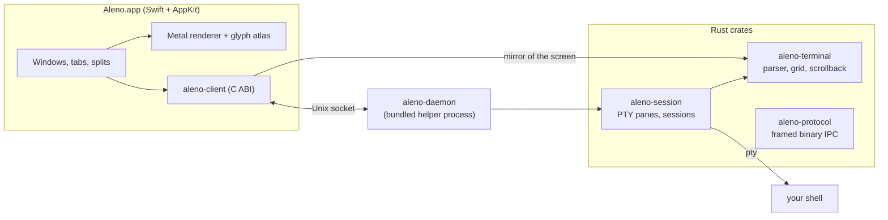

# Architecture

Aleno is a Swift and AppKit app on top of a Rust core. The Rust side owns everything about terminals: parsing, the screen, scrollback, pseudo-terminals and sessions. The Swift side owns everything you see: windows, tabs, splits, the Metal renderer and settings.

## The pieces

| Crate or folder | What it does |
|---|---|
| `crates/aleno-terminal` | The terminal engine. A `vte` parser feeds a grid with scrollback, an alternate screen, Unicode grapheme clusters, hyperlinks, command-block marks, reflow on resize, search, and a VT snapshot that can rebuild a screen. |
| `crates/aleno-protocol` | The wire format between app and daemon: length-prefixed binary frames, versioned, with a hard size limit checked before any allocation. |
| `crates/aleno-session` | Panes (a pseudo-terminal, a shell process and its own terminal state) grouped into sessions, plus the socket server. It also writes the shell-integration scripts and injects them. |
| `crates/aleno-daemon` | A small helper that runs the server on a private Unix socket. The app starts it and it exits with the app. |
| `crates/aleno-client` | The library the app links. It keeps a local mirror of each pane's terminal and exposes a C interface (`app/Application/aleno.h`). |
| `app/` | The AppKit interface: window and tab management, the split tree, the tab bar, settings, notifications and the Metal renderer. |
| `shaders/Terminal.metal` | The vertex and fragment shaders for the text grid. |

## Data flow

1. The shell writes to its pseudo-terminal.
2. In the fast path the daemon hands the pty file descriptor to the app, so the app reads the shell's output itself. A gather thread drains the pty into rotating buffers while a separate parse thread feeds the terminal, so reading never waits for parsing. The daemon path, where output is sent over the socket, is the fallback.
3. The parser updates a `Screen`: grid cells, the cursor, scrollback, command blocks, title, working directory, progress.
4. Every pane has a mirror terminal inside the app process. When it changes, it wakes the view with an event (output, title, bell, command finished, progress).
5. The view asks the mirror for the visible rows, rebuilds only the rows that changed into an instance buffer, and draws.

## Rendering

The text grid is drawn with one instanced draw call per pane. Each cell is one instance of 24 bytes: position, flags, foreground and background colors, and a rectangle in a glyph atlas. Glyphs are rasterized by CoreText on demand into a texture atlas. Ligatures are shaped as a run and drawn as one wide glyph spanning several cells. The view draws only when something changed, uses two drawables to keep latency low, and moves the blinking cursor onto a compositor layer so an idle window uses no CPU.

Overlays such as failure bars, status badges, the find bar and the size badge are Core Animation layers and views on top of the Metal surface.

## Sessions and panes

A window is a session. Each pane has an id inside its session. Closing a window ends its shells. Closing a tab that has been reopened later works from a saved snapshot of the pane's screen and scrollback, which is replayed above a fresh shell, so a reopened tab starts a new process rather than resurrecting the old one.

A window torn off from another window keeps its panes in the original session. The session only ends when the last window using it closes.

## Shell integration

At startup the daemon writes small scripts next to its socket and points the shell at them: zsh through `ZDOTDIR`, bash through `--rcfile`, fish through `XDG_DATA_DIRS`. They emit three standard sequences:

- OSC 133 for prompt start (`A`), command start (`C`, carrying the command text) and command end (`D`, carrying the exit status).
- OSC 7 for the working directory.

The terminal engine turns those into command blocks, which drive the failure bars, notifications and output copying.

## Settings

`~/.config/aleno/settings.json` is read at launch and watched for changes. It is validated key by key, and `schemas/settings.schema.json` describes the same options for editor autocomplete. An invalid file is rejected whole and the previous configuration stays in effect, with a message in the window. Defaults for every key and shortcut live in `app/Configuration/Settings.swift`.

## Testing

- `cargo test --workspace` runs the engine tests (parser, reflow, blocks, snapshots), protocol round trips, and integration tests that start a real daemon with real shells (zsh, sh, `less`, `git`, `nvim`), reattach, slow-client handling and signals.
- `tests/benchmarks/` holds the benchmark scripts described in [Performance](PERFORMANCE.md).
